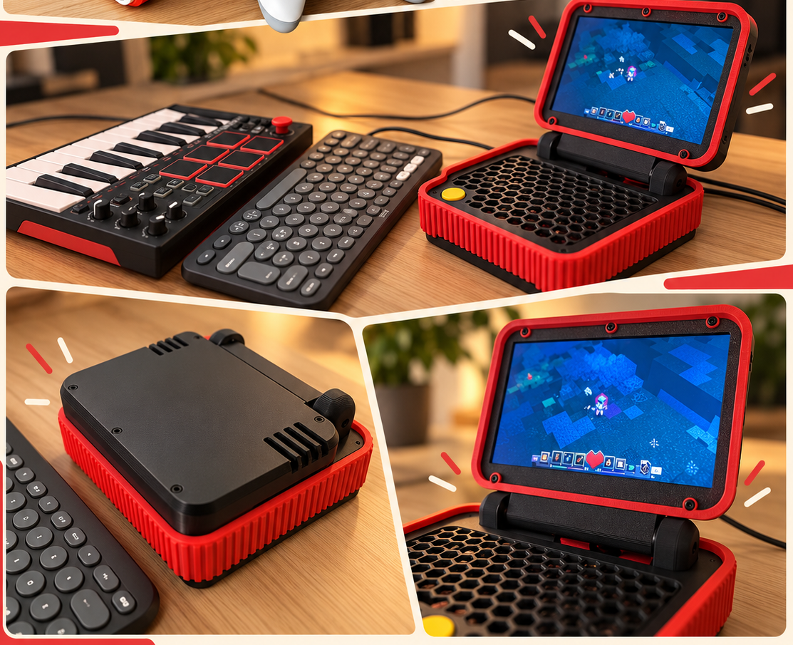

# CyberDeck

I wanted to build a computer in a funky form factor.

There is a community called [r/cyberDeck](https://www.reddit.com/r/cyberDeck/), where people build computers in rather unusual enclosures. Some look like machines a hacker might have carried around in a science fiction movie from the 80s. A lot of the aesthetic inspiration comes from what is known as [cassette futurism](https://www.reddit.com/r/cassettefuturism/). It is a vision of the future imagined in the past. Chunky buttons, mechanical switches, exposed screws, small displays, and an abundance of physical controls. 

I find these aesthetic fascinating.

Many cyberDecks are built around a Raspberry Pi. While it is a wonderful little computer, its performance can be questionable when used as a proper desktop machine. Especially when you start expecting it to behave like a modern PC.

Naturally, a question often comes up. **"What is it for?"**  It sounds like a perfectly reasonable question. After all, when someone builds a computer, we tend to assume there must be something they intend to do with it.

Many of these machines are not necessarily built to solve a problem. They are hobbies. Experiments. They are simply pieces of art that happen to have functioning computers inside them. The purpose is not always found in what the finished machine can do.

In my opinion, the purpose is the journey of making it.

It begins with an image in your head. Something that doesn't exist yet. You start collecting components, measuring dimensions, imagining how things might fit together. Then comes the inevitable realization that half of your brilliant ideas are physically impossible. So you rearrange, you compromise, you try again. Finally, it becomes a tangible object. You can touch it. Turn it on. Hear the fan spinning. Watch the display come to life.

There is a satisfaction in creating something that resembles a prop from a science fiction movie, except that it actually works. I think that satisfaction alone is a perfectly legitimate reason to build a cyberDeck.

And I wanted to experience that pleasure myself.

## A deck I would actually use

I wanted to build something that I wanted to find it useful. Doesn't have to be a daily driver. But, something that I can carry around easily enough, and it's powerful enough so that I don't have to wait too long to do something.

A little retro gaming rig. That has enough power to run casual games without a burden.

I already had a mini PC. Intel N100 CPU. Which was designed to be low powered but powerful enough to run quite a decent tasks. It's far more powerful than raspberry pi. In other words, it was a proper PC.

## And something beautiful to look at

If I am going to play music on it. I want a bit of spark. Don't want to make it feel like a work. I want a playful setup. 

Let's see if I can or got there this time.

# Build notes

There is almost no soldering in this build. One point, and only one. Extending the power button out to a Cherry MX switch inside the case. Everything else is cables and screws. The enclosure is 3D printed, with heat inserts melted into the plastic and M2 and M3 screws holding it all together.

## Bill of materials

| Part                                                                                                     | Spec                           |
| -------------------------------------------------------------------------------------------------------- | ------------------------------ |
| [Beelink MINI S12 PRO](https://www.amazon.it/dp/B0BYYQTNYV)                                              | Mini PC, Intel N100            |
| [Wisecoco 7-inch display](https://www.wisecocodisplay.com/product/7-inch-1920-1080-tft-ips-lcd-display/) | 1920 × 1080 TFT IPS LCD        |
| [Anker USB 3.0 hub](https://www.amazon.it/dp/B00Y211AFM)                                                 | 4 ports                        |
| Mini HDMI to HDMI cable                                                                                  | display to PC                  |
| USB A to C cable                                                                                         | display power                  |
| Cherry MX switch                                                                                         | 1 ×, the extended power button |
| M3 hex screws                                                                                            | DIN 912, 10 mm                 |
| M2 machine screws                                                                                        | DIN 7046, 5 mm                 |
| M3 heat-set inserts                                                                                      | OD 4.5 mm, 3 mm long           |
| M2 heat-set inserts                                                                                      | OD 3.2 mm, 3 mm long           |

3D print files are located in [STL folder](./STL)

# Build Guide

[YouTube Video with Build Guide](https://youtu.be/EUU2UdWa4cw)

## Support

This is an open-source project, built through many small experiments, revisions, failed prints, measurements that turned out to be wrong, and a fair amount of coffee.

If it helped you build something of your own, gave you an idea, or was simply enjoyable to read, you can support the project by buying me a coffee.

It helps me keep experimenting, documenting new revisions, and sharing everything openly with the community.

* [Buy me a coffee](https://www.buymeacoffee.com/unkyulee)

Un Kyu Lee